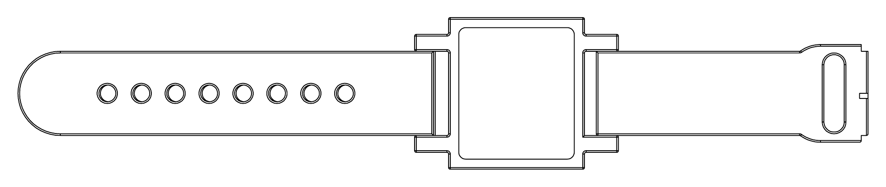
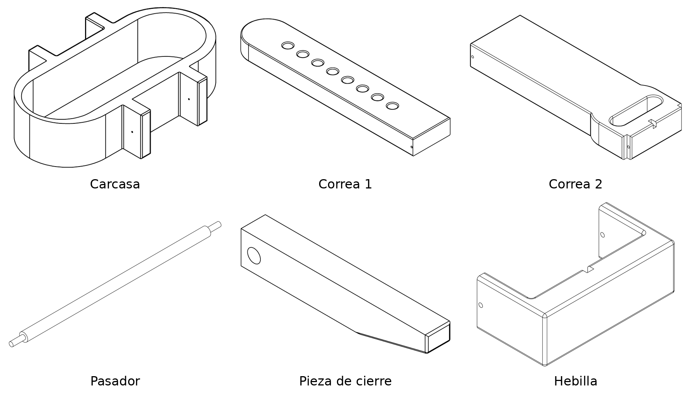

# PasSegur

Pulsera inteligente para la **navegación accesible de peatones**. Está pensada para personas con movilidad reducida o discapacidad visual y funciona junto a una aplicación móvil que calcula rutas sin barreras arquitectónicas (escaleras, pendientes, aceras estrechas, pavimento en mal estado…).

La pulsera guía al usuario sin que tenga que mirar el móvil. Usa **vibraciones hápticas** diferenciadas para avisar de giros, desvíos de la ruta y obstáculos, y puede emitir alertas en situaciones de riesgo.

> Proyecto académico de la asignatura **GEPR-EGD**, grupo **GP08**. Tutor: Marc Escola Fernández.



---

## Diseño mecánico

El diseño mecánico se ha hecho en **SolidWorks 2025** y está formado por las siguientes piezas:



| Pieza | Descripción |
|---|---|
| Carcasa principal | Caja con cierre estanco (tapa superior + base) que aloja la PCB, la batería Li-Po y el motor háptico |
| Correa 1 | Tramo de correa de plástico con agujeros equidistantes para ajustar la talla |
| Correa 2 | Segunda mitad de la correa, con ventana oblonga para el pasador |
| Aguja / pasador | Eje cilíndrico que une las correas con la carcasa |
| Pieza de cierre | Brazo móvil del cierre, con punto de giro y rampa de bloqueo |
| Hebilla | Pieza en "U" para el anclaje rápido de la correa |

Criterios de diseño: ergonomía para el uso prolongado, protección frente a golpes, polvo y humedad, materiales hipoalergénicos, y un cierre seguro pero fácil de manipular para personas con poca destreza manual.

### Estructura del repositorio

```
pulsera-pas-segur/
├── version1/   # Primera versión: piezas (.SLDPRT) y ConjuntoDispositvo.SLDASM
├── version2/   # Versión revisada: piezas y ConjuntoDispositvov2.SLDASM
├── Planols/    # Planos acotados de cada pieza y del conjunto (PDF)
└── img/        # Imágenes del README
```

### Abrir el proyecto

1. Clona el repositorio.
2. Abre `version2/ConjuntoDispositvov2.SLDASM` (o el de `version1`) **desde la carpeta clonada**.

Todas las piezas están dentro del repositorio, así que las referencias se resuelven solas sin depender de la ruta ni de la instalación de cada equipo.

> ⚠️ Para renombrar archivos, hazlo desde SolidWorks y no desde el explorador de Windows ni con `git mv`. Si no, el ensamblaje pierde las referencias.

---

## Electrónica

| Componente | Referencia |
|---|---|
| MCU / SoC BLE | Nordic nRF52840 |
| GNSS | u-blox MAX-M10S |
| Gestión de carga | TI BQ25120A |
| IMU (6 ejes) | Bosch BMI270 |
| Secure Element | Microchip ATECC608B |
| Memoria Flash | Winbond W25Q32JV |
| Actuador háptico (LRA) | Jinlong G0832001 |
| Batería | Li-Po 3,7 V, 300 mAh |

---

## Equipo

**Parte mecánica**
- Guillem Sillué Cecilia — [@guisice03](https://github.com/guisice03)
- Joan Favà Garcia

**Parte eléctrica**
- Pablo Salcedo
- Alex Clivillé Bazán
- Pol Sabaté Cuadrat
